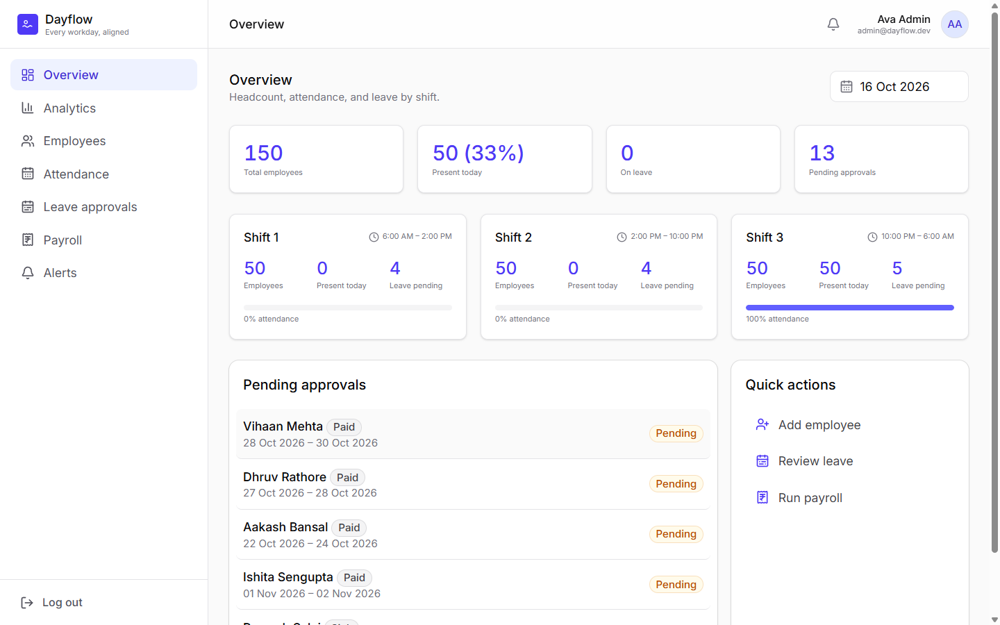

# Dayflow HRMS

Human Resource Management System — Odoo Hackathon project.

**Live:** https://dayflow-odoo-hackathon.vercel.app (laptop or desktop only; one-click demo logins on the sign-in page; the live demo runs on built-in sample data)



## Features

- **Dashboards** — HR admins see headcount, attendance and leave by shift; employees see their own day at a glance
- **Attendance** — check in and out, daily and weekly views, present / absent / half-day / leave status
- **Leave** — employees apply with type, dates and remarks; HR approves or rejects with comments
- **Payroll** — employees view their salary; HR manages every salary structure and downloads payslips as PDF
- **Employees** — invite staff, assign shifts, deactivate accounts, keep profiles and documents
- **Analytics & alerts** — attendance and leave trends, plus alerts for things HR should act on
- **Roles** — HR admin and employee each see only what they should

The original problem statement is in [`docs/`](docs/).

### 🔑 Demo Logins

<table>
<tr><th>Role</th><th>Email</th><th>Password</th></tr>
<tr><td>🧑‍💼 Employer (HR admin)</td><td><code>admin@dayflow.dev</code></td><td><code>Password123</code></td></tr>
<tr><td>👤 Employee</td><td><code>aditya.verma@dayflow.dev</code></td><td><code>Password123</code></td></tr>
</table>

## Stack

| Layer | Tech |
|---|---|
| Frontend | React 19 + Vite + TypeScript + Tailwind CSS v4 |
| Backend | Node.js + Express + Prisma ORM |
| Database | PostgreSQL on [Neon](https://neon.tech) |
| Hosting | Frontend → Vercel · Backend → Node host |

## Local Setup

### Backend
```bash
cd backend
cp .env.example .env   # Add DATABASE_URL (Neon) and JWT_SECRET
npm install
npx prisma generate && npx prisma migrate dev
npm run dev            # http://localhost:3000
```

### Frontend
```bash
cd web
cp .env.example .env   # Set VITE_API_URL=http://localhost:3000
npm install
npm run dev            # http://localhost:5173
```

## Deployment

- **Frontend** → Import `web/` into Vercel, set `VITE_API_URL` env var.
- **Backend** → Deploy to any Node host (Railway, Render, Fly.io), set `DATABASE_URL` + `JWT_SECRET`.
- **Database** → Get connection string from Neon Console. Run `npx prisma migrate deploy` in CI.

## Structure

```
dayflow-hrms/
├── backend/   # Express API, Prisma schema, migrations
├── docs/      # Problem statement and team workflow notes
└── web/       # React + Vite frontend
```
